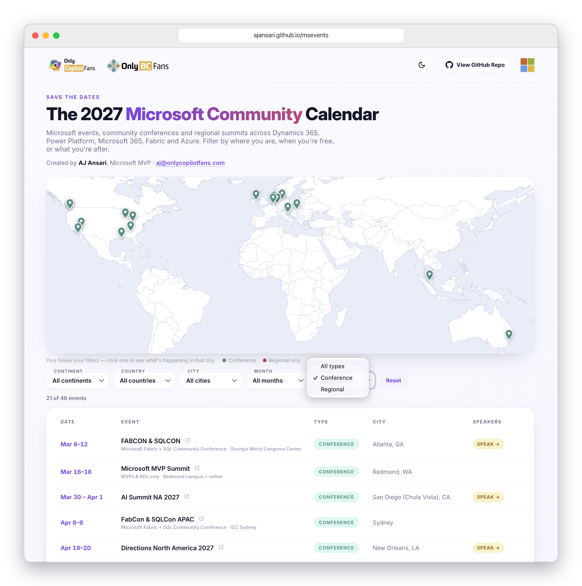

# 2027 Microsoft Community Calendar

A single-page calendar of 2027 Microsoft events, community conferences and regional summits across Dynamics 365, Power Platform, Microsoft 365, Fabric and Azure.

**Live site: [ajansari.github.io/msevents](https://ajansari.github.io/msevents)**

[](https://ajansari.github.io/msevents)

Visitors can filter events by continent, country, city, month and type, see them pinned on a world map, and jump to each event's website or call for speakers.

Created by AJ Ansari, Microsoft MVP ([onlycopilotfans.com](https://onlycopilotfans.com) · [onlybcfans.com](https://onlybcfans.com)).

## Features

- **Event table** listing the date, name, type (Conference or Regional), location and a "Speak →" link where a call for speakers is open.
- **Linked filters** for continent, country, city, month and type. Each dropdown only offers values that still match the other filters, and a Reset button clears them all.
- **World map** with one pin per city. Teal pins mark cities with at least one conference and rose pins mark cities with regional events only. Clicking a pin lists that city's events.
- **Auto-zoom**: the map shows the whole world by default and zooms to the remaining pins as filters narrow the list.
- **Responsive layout** that works on phones as well as desktops.

## Running it

The whole project is one file, [index.html](index.html), with no build step, dependencies or network requests. The styles, script, logos and world map are all inline.

To view it locally, open `index.html` in a browser. The live site at <https://ajansari.github.io/msevents> is served by GitHub Pages from this repository, and the file works on any other static host too.

## Updating the events

All data lives in the `<script>` block at the bottom of [index.html](index.html).

### Add or edit an event

Each event is one object in the `EVENTS` array. Keep the array in date order, because the table renders it as written.

```js
{d:"May 17–20", m:"May", n:"DynamicsCon 2027", t:"Conference",
 city:"Las Vegas", loc:"Las Vegas, NV", country:"USA", cont:"North America",
 url:"https://dynamicscon.com/", cfs:"https://sessionize.com/dynamicscon-2027"}
```

| Field | Required | Meaning |
|---|---|---|
| `d` | Yes | Date as displayed, such as `"Feb 9"` or `"Mar 8–12"`. Use the month name alone for preliminary dates, or `"TBA"`. |
| `m` | Yes | Full month name used by the Month filter, or `"TBA"`. |
| `n` | Yes | Event name. |
| `t` | Yes | `"Conference"` or `"Regional"`. |
| `city` | Yes | City used by the City filter and the map pin. Must match a key in `COORDS`. |
| `loc` | Yes | Location as displayed, such as `"Irving (Dallas), TX"`. |
| `country` | Yes | Country used by the Country filter. |
| `cont` | Yes | Continent used by the Continent filter. |
| `url` | No | Event website. Without it, the name is shown as plain text. |
| `cfs` | No | Call-for-speakers link, shown as "Speak →". |
| `tag` | No | Short subtitle under the event name, such as the venue. |

Events without confirmed details use `"TBA"` for `d`, `m`, `city`, `country` and `cont`. They appear in the table but not on the map.

### Add a new city

A pin appears only if the event's `city` has an entry in `COORDS`, as `[latitude, longitude]` in decimal degrees:

```js
"Budapest":[47.50,19.04]
```

### Shared links

The `ROADSHOW`, `REGIONALS` and `DFP_SPEAK` constants at the top of the script hold URLs shared by several events. Change them once to update every event that uses them.

## How the map works

The world outline is an inline SVG path drawn in a simple equirectangular projection, where x is longitude × 10 and y is −latitude × 10. `drawMap()` sets the SVG `viewBox` to frame the filtered cities, then positions each pin as an HTML button over the map using the same longitude and latitude maths. The map redraws when the window is resized.

## Notes on the data

- All dates are for 2027 and are subject to change.
- Entries that show only a month are preliminary.
- Microsoft Build and Microsoft Ignite 2027 dates and venues have not been announced by Microsoft.

## Disclaimer

This is an independent community project. It is not created, sponsored or endorsed by Microsoft, and it is not affiliated with Microsoft. Microsoft and the Microsoft logo are trademarks of the Microsoft group of companies, used here only to identify the events and products this calendar covers. All other names and logos belong to their respective owners.

## Contributing

This is an open-source project, and corrections and additions are welcome. If an event is missing, has moved or has confirmed its dates, open an issue or send a pull request that edits the `EVENTS` array as described above.

## License

Released under the [MIT License](LICENSE).
